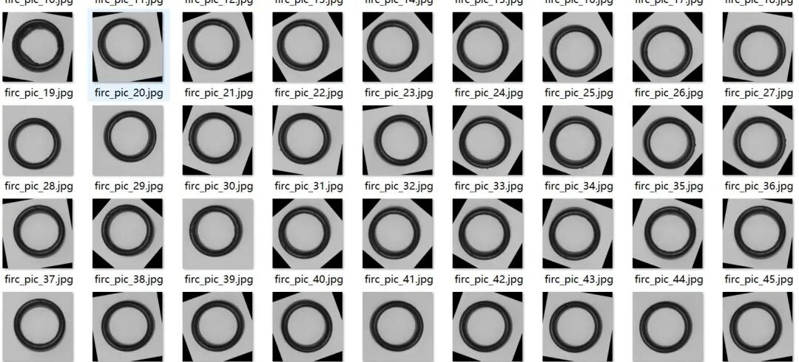
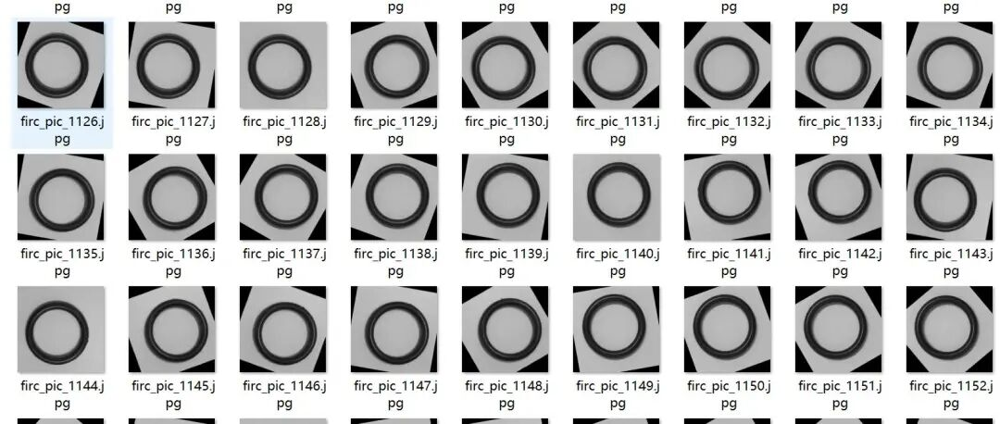
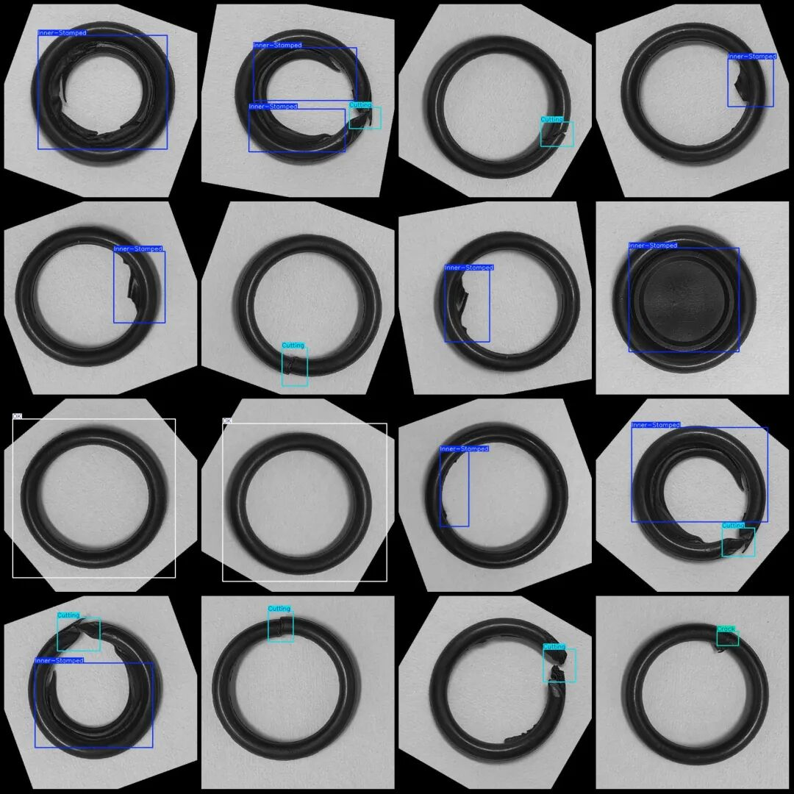
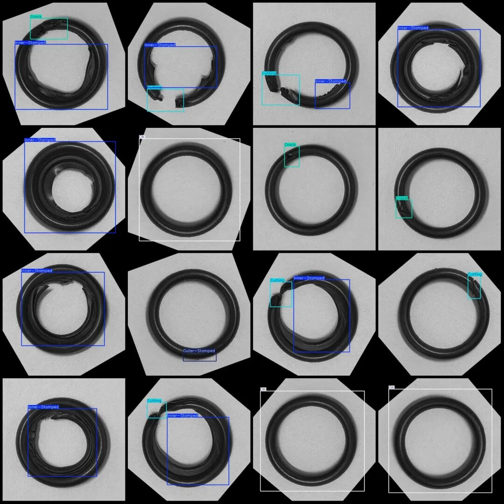

# Sealing Ring Quality Detection Dataset - Sealing Ring Defect Detection VOC+YOLO format with 1295 images in 5 categories with enhanced

Please note that the dataset contains a large number of rotated augmented images. It is estimated that there are only about 50 original images, please take a look at the image previews.

Dataset format: Pascal VOC format + YOLO format (txt file without split path, only containing jpg images and corresponding VOC format xml files and yolo format txt files)

Number of images (number of jpg files): 1296

Number of annotations (number of xml files): 1296

Number of annotations (number of txt files): 1296

Label category count: 5

Label category names (note that the order of yolo format categories does not correspond to this, but is based on the labels folder's classes.txt): ["Crack", "Cutting", "Inner-Stamped", "OK", "Outer-Stamped"]

Number of boxes labeled in each category:

Crack (cracks) Frames = 266

Cutting (cutting) frame count = 318

Inner-Stamped (inner stamping) Frame Count = 866

OK (qualified) Frames = 175

Outer-Stamped (outer stamping) frame count = 191

Total frame count: 1816

Number of images per category:

Crack (crack) occupies a picture count = 247

Cutting (cutting) occupies a picture count = 318

Inner-Stamped (Inner Stamping) occupies a picture count = 735

OK (qualified) Ownership of the image = 175

Outer-Stamped (outer stamping) occupies = 190

Image resolution: 640x640

Using labelImg:

Annotation rules: Draw a rectangle around the category.

Important Notice: The dataset does not have separate training, validation, and test sets; you need to partition them yourself.

Special : This dataset does not guarantee the accuracy of the trained models or weight files.

Image Preview:

Annotation example:

## Payment

Here is a pay link on Stripe ( https://buy.stripe.com/3cs8yP7sY87d0vu9AB ). Please contact me lonlonago@foxmail.com after funding $89, and I will send you a complete data files , thank you!

